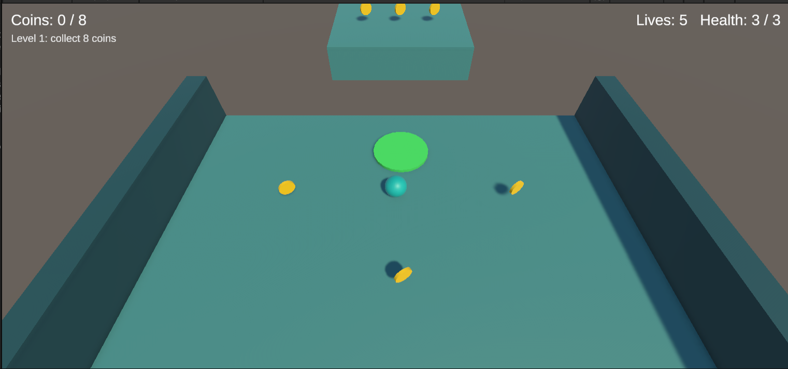
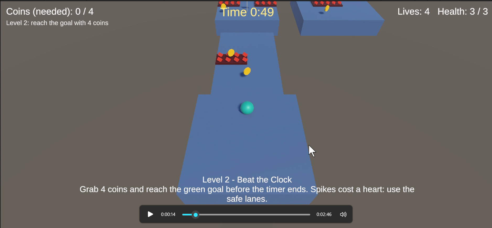
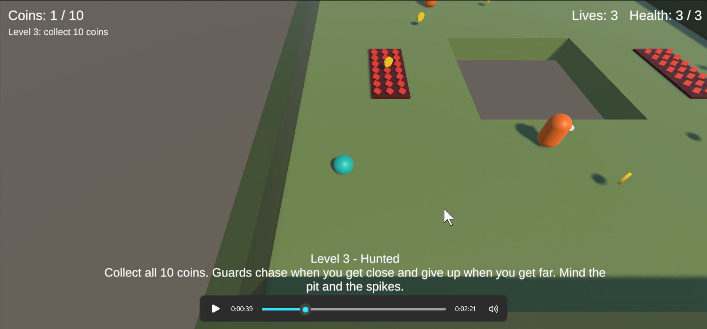
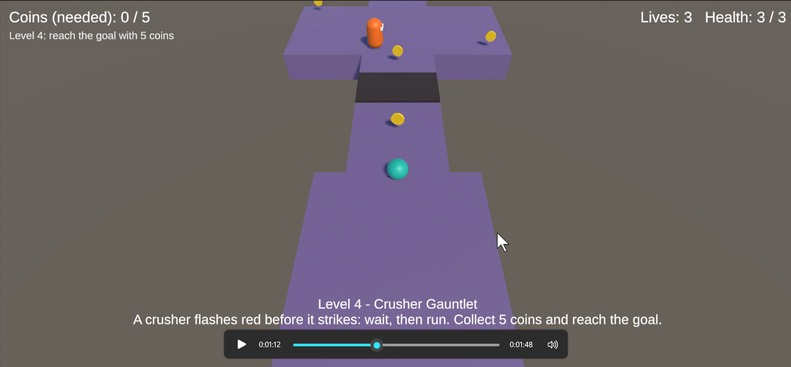
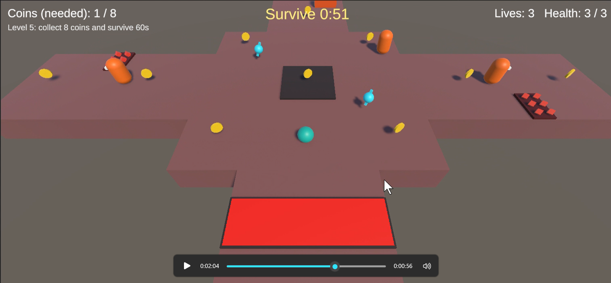

# CS464 Assignment 03 · Saleha Bilal · [Roll no]

- **Video (60–120 s):** (https://drive.google.com/file/d/1qSGXFwyhGHBCc0tULDS3QLGwfgHwlYxC/view)
- **Started from:** new levels
- **Controls:** **W A S D** or the **arrow keys** roll the ball, **Space** jumps. **R** restarts the level at any time. On the win panel, **Enter** (or **N**) goes to the next level. Both panels also have clickable Restart / Next Level buttons.
- **To win a level:** each level has its own goal, shown at the top of the screen.
  - Level 1: collect all 8 coins.
  - Level 2: collect 4 coins, then reach the green goal within 50 s.
  - Level 3: collect all 10 coins.
  - Level 4: collect 5 coins, then reach the goal.
  - Level 5: collect 8 coins and survive 60 s.

## Levels

| Level | Screenshot | New idea | Combined with |
|---|---|---|---|
| Level01 |  | Coins, the score and the win panel, and a bounce pad (a one-off `VelocityChange` launch) to reach a raised ledge. Nothing hurts; falling off still costs a life. | Nothing yet: this level teaches the basics safely. |
| Level02 |  | Spikes that take one heart at a time (with i-frames), a countdown timer, and a checkpoint. | Level 1's coins and win rule: the goal now needs 4 coins before it accepts you. |
| Level03 |  | Guards that patrol, chase when you get close, and give up when you get far (one loops round a pit, one ping-pongs). | Level 2's spikes sit beside the guards' routes; Level 1's "collect them all" rule. |
| Level04 |  | The crusher: it flashes red for 0.7 s before it strikes, so a careful player can always time it. | Level 3's guard chases you down the corridor next to it; Level 2's checkpoint and goal. |
| Level05 |  | Two timed speed boosts placed close enough to be taken while the first is still running, plus a "collect 8 coins and survive 60 s" win rule. | Everything: chasing guards, a sweeper, crushers, spikes, a checkpoint-free open-edged platform. |

## The numbers

| Number | Value | Why this value |
|---|---|---|
| Patrol speed | 2 to 2.5 m/s | The ball tops out at about 6.75 m/s (27 N of force against a drag of 4), so a patrolling guard walks at roughly a third of your speed. You can always outrun one, but you have to plan a route past it. |
| Chase range | 5 to 7 m (give-up range 8 to 10 m) | Chase speed is 3.3 to 3.5 m/s, still about half of your speed. A guard can see about one platform-width around its route but not the whole room, and the give-up range is larger than the chase range so it doesn't flicker on and off at the edge. |
| Knockback | `ForceMode.Impulse` of 8 (10 for the crusher), steering locked for 0.25 s | A hit throws the ball about 2 m (8 m/s against a drag of 4) [confirm this by measuring in play before you submit]. That is enough to leave a spike strip or a guard's reach, but not enough to throw you off a narrow platform every time. Gravity is not affected: the push is flattened so it never launches you upward. |
| I-frames | 1 s | About the time it takes to get clear after a hit: the knockback carries you out in roughly 0.5 s, and the rest lets you turn and move away. Without it, standing on spikes would take a heart every physics step. |
| Power-up duration | 5 s (speed x1.6) | Long enough to cross a whole arm of Level 5 or get away from a guard, but not long enough to collect every coin on the level in one boost, so the second pickup matters. |

## Short answers

**1. Why does a trigger need a Rigidbody on at least one of the two objects?**
Unity only sends trigger and collision messages for pairs where the physics engine is actually simulating at least one body, and that needs a Rigidbody. Two plain colliders are treated as static scenery and never report an overlap. In my game the Player has a non-kinematic Rigidbody, which is what makes `Coin`, `PowerUp`, `Goal` and `KillZone` fire when the ball touches them, and the guards and crusher have kinematic Rigidbodies so their `Hazard` triggers fire as well.

**2. Which ForceMode do your knockback and your Part A force use, and why each?**
Knockback (`Hazard` calling `PlayerController.Knockback`) uses `ForceMode.Impulse`: it is a single kick applied once when a hit lands, and the ball's mass is part of it (velocity change = impulse / mass). My Part A force, the bounce pad, uses `ForceMode.VelocityChange`, because a launch pad should send anything up at the same 9 m/s whatever its mass, and it is applied once on entry, not every step. The ball's normal movement uses the default `ForceMode.Force` every physics step.

**3. What does your code do when a second power-up is picked up while one is running?**
It refreshes. `PlayerController.BoostSpeed` stops the running coroutine and starts a new one, so the newest pickup wins and the clock restarts. It does not stack the multiplier or add the leftover time. Two 5 s pickups taken 3 s apart end at 8 s, and the speed goes back to normal exactly once. The timer lives on the player, not on the pickup, because destroying the pickup would stop a coroutine started there.

**4. Why can `==` fail as an arrival check, and when does it work?**
Positions are floats, so a guard that moves a little each frame rarely lands exactly on the waypoint, and it can step past it. `==` only works right after `Vector3.MoveTowards`, because that clamps to the target and never overshoots. It is unreliable once anything else moves the object (a chase, a rotation, a physics push, rounding). My `EnemyGuard.Arrived` uses `Vector3.Distance(...) < arriveDistance` (0.1 m), which also works when the guard is returning from a chase and arrives from some other direction.
